## TP3 : Gestion De Réservation 

1. Vue d'ensemble du projet dans l'IDE avec la structure des packages, le fichier de configuration de persistance et la classe principale d'exécution.
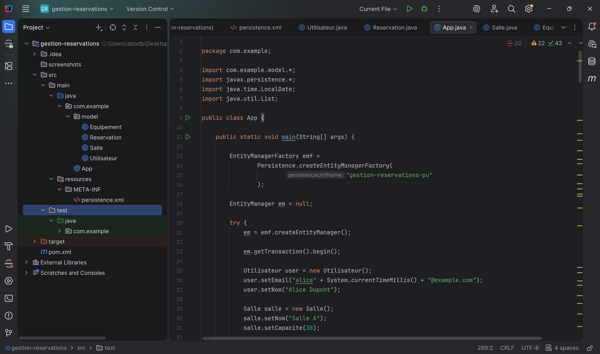
2. Configuration du fichier persistence.xml définissant l'unité de persistance, la connexion à la base de données et les paramètres Hibernate.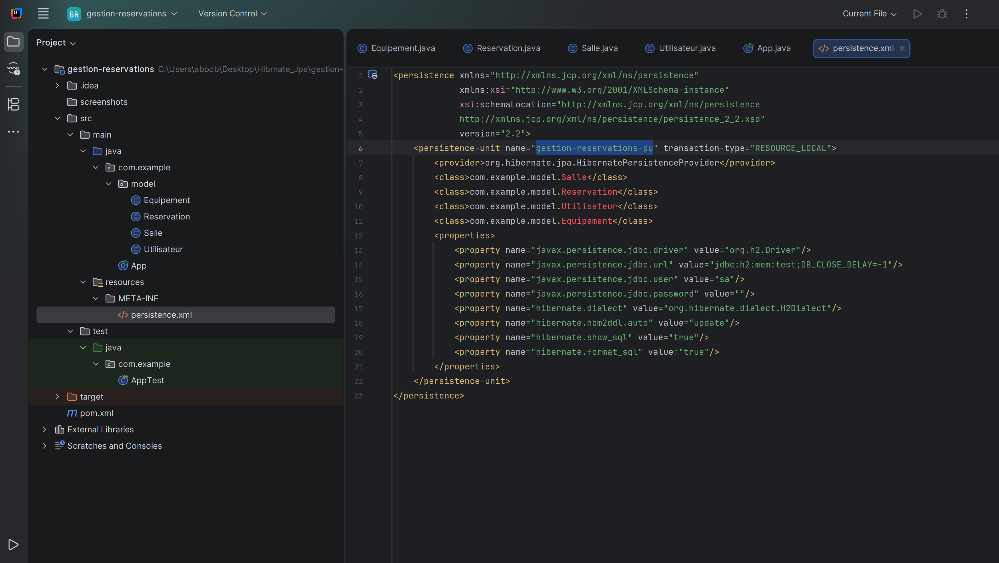
3. Déclaration des bibliothèques nécessaires au fonctionnement du projet, incluant JPA (API Hibernate) et le pilote de la base de données H2.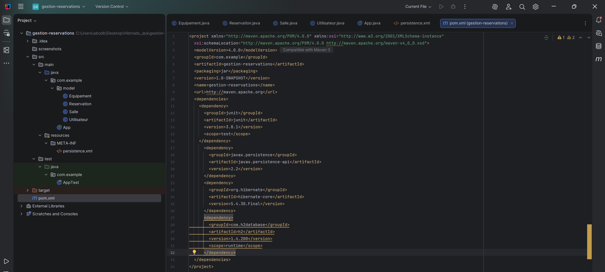
4. Définition de l'entité Equipement avec ses attributs et son association Many-to-Many avec les salles.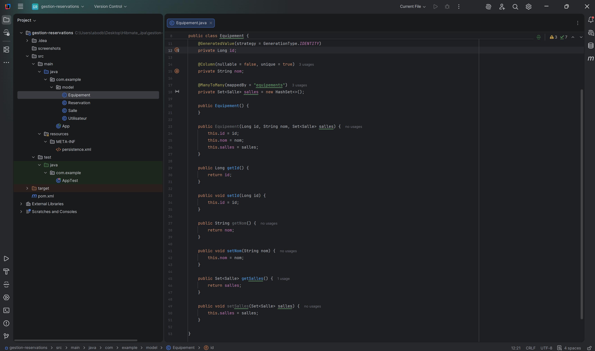
5. Structure de l'entité Reservation reliant un utilisateur et une salle via des relations Many-to-One et Implémentation des règles de gestion et de validation des dates de début et de fin de réservation.
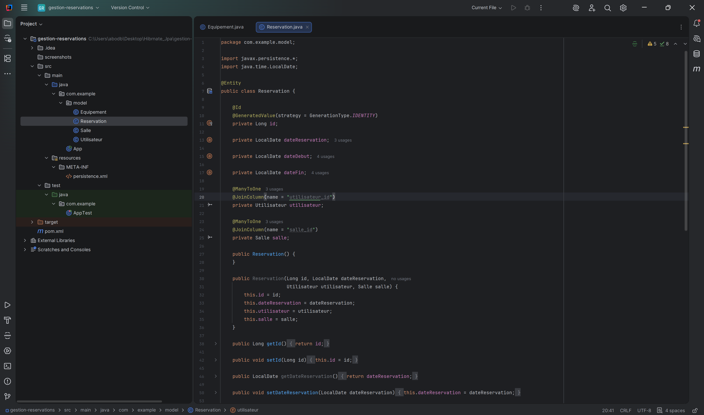
6. Définition de la classe Salle avec ses propriétés, la gestion des réservations en cascade et la liaison avec les équipements.
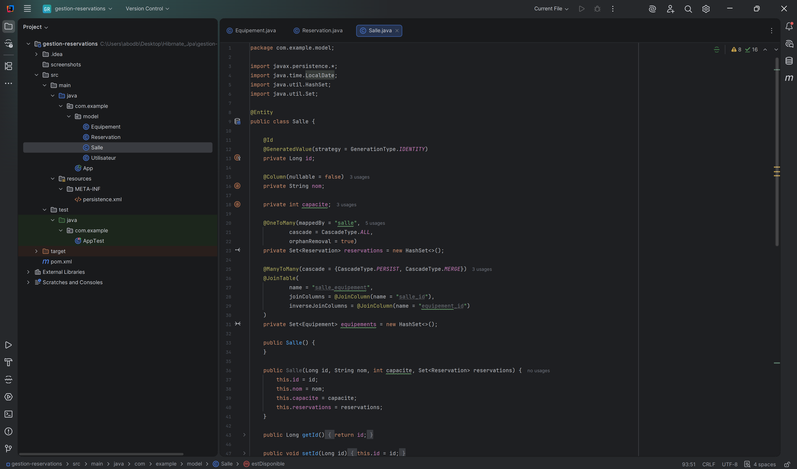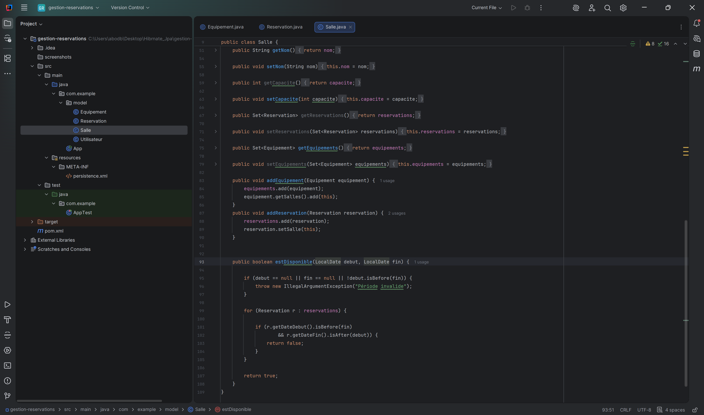
7. Définition de la classe Utilisateur avec ses contraintes d'unicité sur l'email et ses informations personnelles.
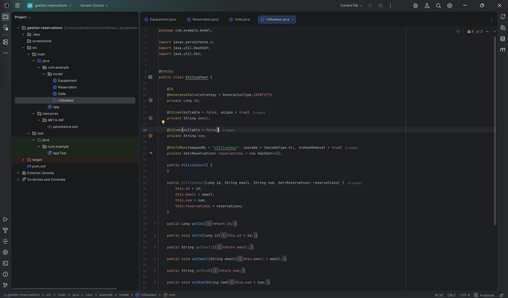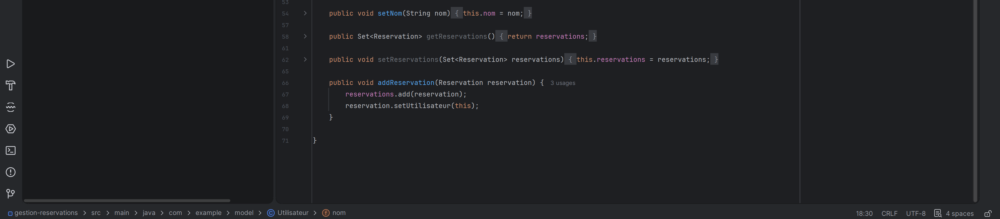
8. Initialisation d'un utilisateur, d'une salle et d'un projecteur, puis persistance des objets via l'EntityManager.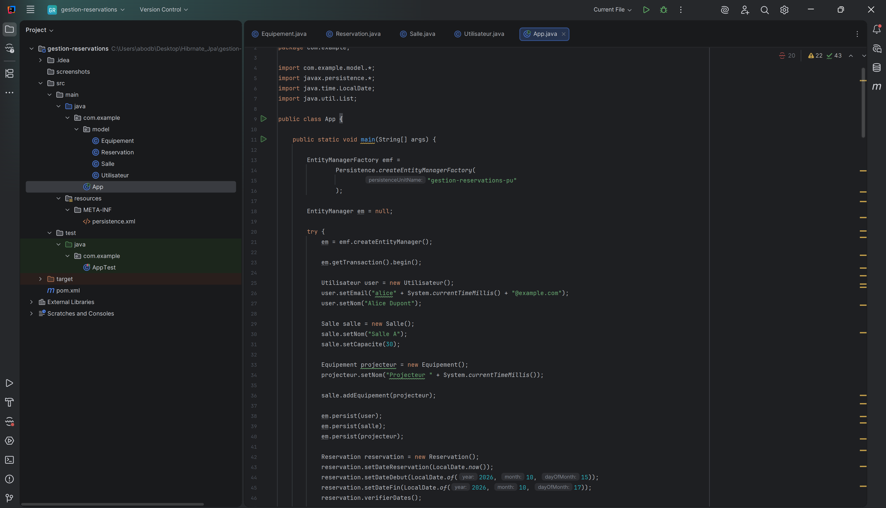
9. Exécution des requêtes JPQL pour récupérer les réservations d'un utilisateur et rechercher les salles équipées d'un projecteur.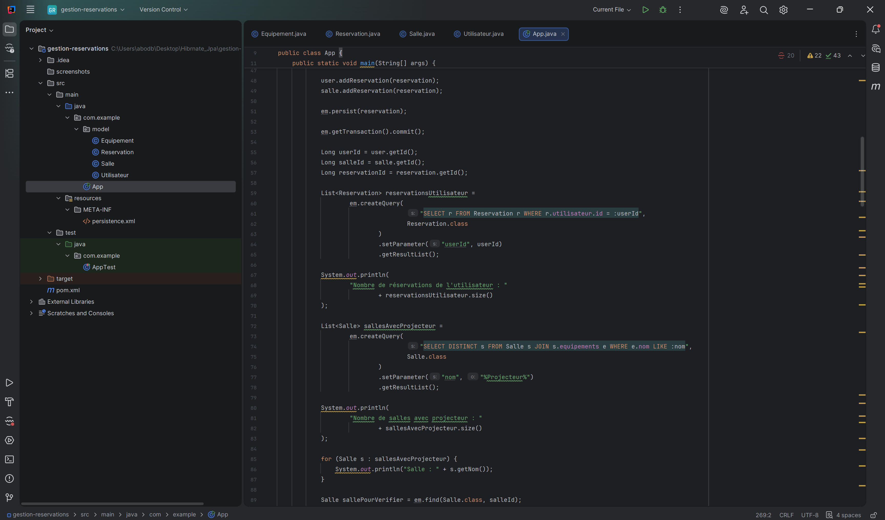
10. Appel de la méthode métier de vérification des chevauchements de dates pour une salle, recherche d'entités par ID et modification transactionnelle du nom d'une salle.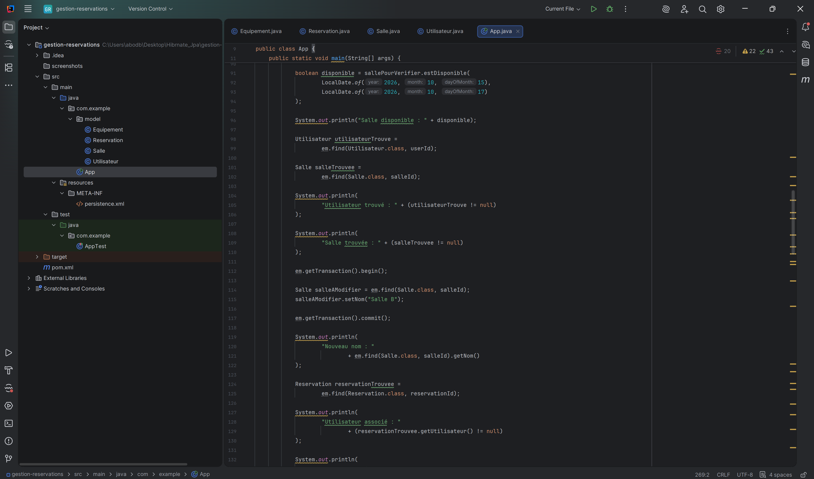
11. Test de la suppression en cascade (CascadeType.ALL) permettant de vérifier qu'en supprimant un utilisateur, ses réservations associées sont automatiquement nettoyées.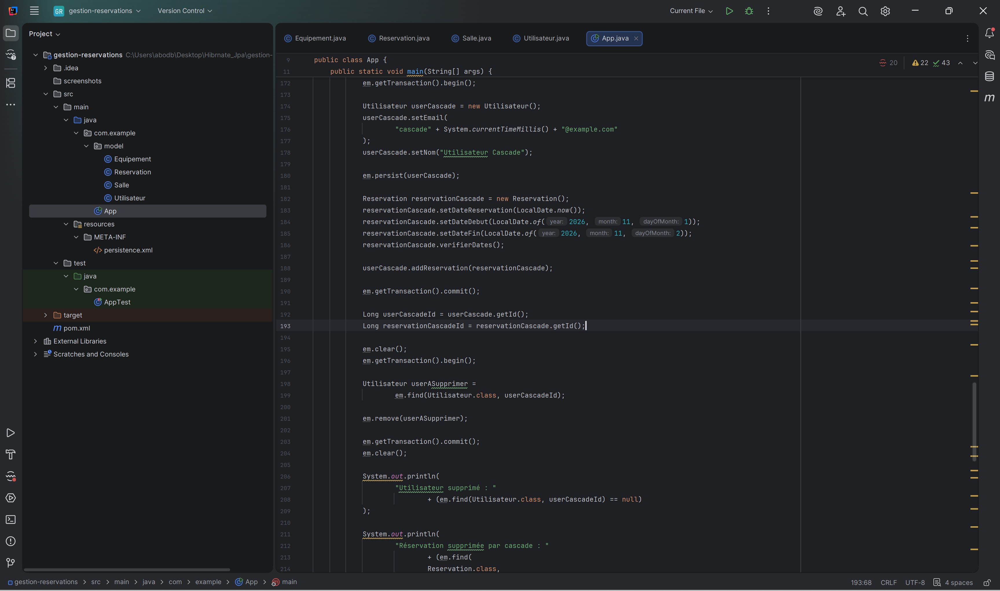
12. Affichage du message de confirmation de la réussite de tous les tests, gestion propre des exceptions JPA/transactions, et fermeture des gestionnaires de persistance.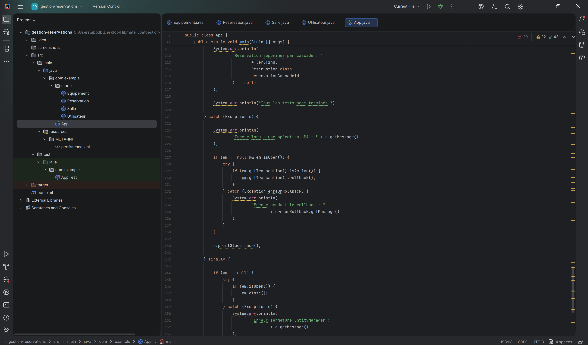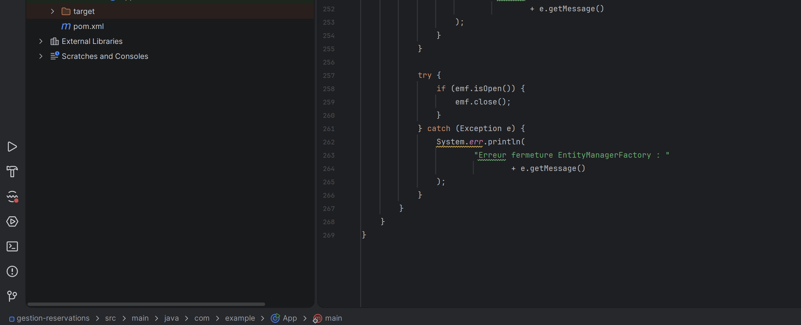
13. Traçage de la création des tables principales (Equipement, Reservation, Salle, salle_equipement, et Utilisateur) par l'ORM au démarrage de l'application.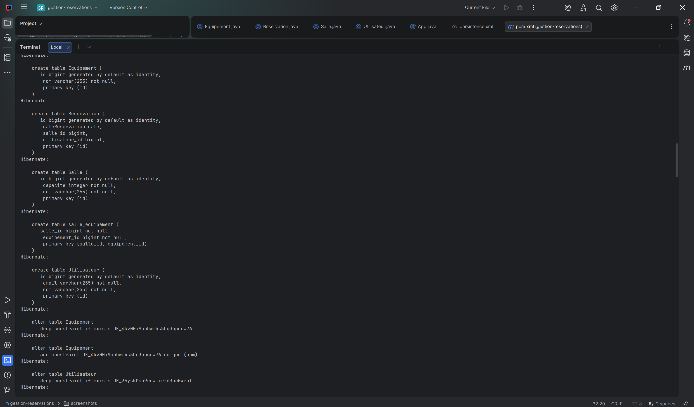
14. Application des clés étrangères, des contraintes d'intégrité référentielle, suivies des premières requêtes SQL d'insertion (INSERT) pour les entités métier.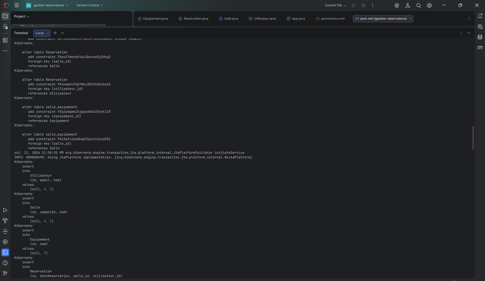